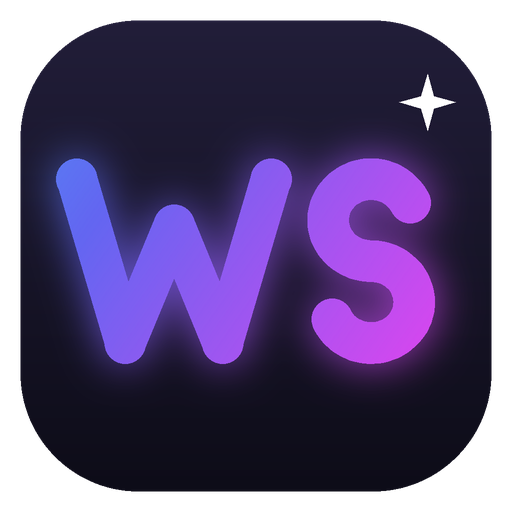
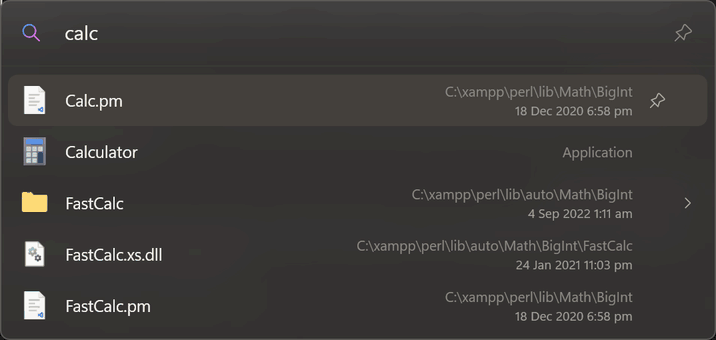

<p align="center">
  
</p>

<h1 align="center">Wydscop</h1>

<p align="center"><i>Pronounced "wide scope"</i></p>

<p align="center">
  <a href="https://github.com/xnoire666/wydscop/actions/workflows/build.yml"></a>
  <a href="https://github.com/xnoire666/wydscop/releases/latest"></a>
  <a href="https://scorecard.dev/viewer/?uri=github.com/xnoire666/wydscop"></a>
  <a href="LICENSE"></a>
</p>

A fast, Spotlight-style search bar for Windows. Press **Alt+Space** anywhere, type a few letters,
and open any app, file or folder on your PC.

Built with C# and WPF on .NET 10. Everything runs locally: no accounts, no network, no telemetry.

<p align="center">
  
</p>

<p align="center">
  <a href="https://apps.microsoft.com/detail/9P47NSX5N7RJ"></a>
</p>

**Download:** install it from the [Microsoft Store](https://apps.microsoft.com/detail/9P47NSX5N7RJ) (signed by
Microsoft, updates automatically), or get `Wydscop.exe` from [Releases](https://github.com/xnoire666/wydscop/releases).
The exe is a single file for Windows 10/11 (x64); no install or .NET needed.

**Check your download.** The exe isn't code-signed, so Windows may warn about it. To check it's the
genuine file, built by this repository's GitHub Actions from its public source, verify its build
attestation with the [GitHub CLI](https://cli.github.com/):

```bash
gh attestation verify Wydscop.exe --repo xnoire666/wydscop
```

Or compare its checksum with the release's `SHA256SUMS.txt` (or the SHA-256 in the release notes):

```powershell
Get-FileHash Wydscop.exe
```

---

## Features

- **One shortcut, everywhere.** Alt+Space opens the bar on top of every window, on the monitor your mouse is on.
- **Apps, files and folders** in one list:
  - apps from the Start menu (desktop and Store apps);
  - files and folders on all fixed drives, from the **Windows Search index** (your user folders) plus
    Wydscop's **own index** for everything Windows doesn't index (e.g. `C:\xampp`, other drives).
- **Smart ordering.** Best match first (exact name, starts with, word start, initials, contains,
  letters in order); results that match the same way are ordered **newest first** by date and time.
- **Typo tolerant.** `chorme` → Chrome, `calculater` → Calculator (only when nothing matches normally).
- **Dates on every row.** Modified date (or created, if never modified), shown under the path.
- **Look inside folders** without leaving the bar: **→** on a folder shows its contents, **←** goes back
  to exactly where you were.
- **Recent and Pinned.** The empty bar shows what you opened recently and the results you pinned.
- **Pin the bar** to keep it open and in place while you work.
- **Move and resize.** Drag the bar anywhere and drag its edges to change the width; it remembers both.
- **Windows 11 look.** Frosted acrylic background, native rounded corners and shadow,
  **Dark** (the default) / **Light** / **Match Windows** themes.
- **No result limit.** 10 rows are visible; the rest scroll and load as you go.

## Requirements

- Windows 10 or 11 (x64). The acrylic background needs Windows 11 22H2 or later; older versions get a
  solid background.
- [.NET 10 SDK](https://dotnet.microsoft.com/download) to build.
- Windows Search service running (it is by default) for fast search in your user folders.

## Build and run

```bash
dotnet build Wydscop.slnx -c Release
```

```bash
dotnet run --project src/Wydscop
```

Wydscop starts in the notification area (tray) and turns on **Start with Windows** on first launch.
Exit it from the tray menu before rebuilding, since the running app locks its `.exe`.

Setting up to develop on another PC (clone, commit settings, moving your data): see [HANDOVER.md](HANDOVER.md).
If you forked the repo, commit with your own GitHub identity.

To make a standalone build you can copy to another PC:

```bash
dotnet publish src/Wydscop -c Release -r win-x64 --self-contained -p:PublishSingleFile=true -p:IncludeNativeLibrariesForSelfExtract=true -p:EnableCompressionInSingleFile=true -o publish
```

To build the Microsoft Store package (MSIX), see [packaging/README.md](packaging/README.md).

## Using it

| Key / action | What it does |
|---|---|
| **Alt+Space** | Open the bar (or close it) |
| Type | Search apps, files and folders |
| **↑ / ↓**, **Page Up / Page Down** | Move through results |
| **Enter** / click | Open the highlighted result |
| **Ctrl+Enter** | Show the file or folder in File Explorer |
| **Ctrl+click** / **Ctrl+Space** | Mark several results, then **Enter** opens them all |
| **→** on a folder (or click its **›**) | Look inside the folder |
| **←** (cursor at start) / **Backspace** (empty) | Go back one folder |
| **Ctrl+P** (or the pin on a row) | Pin or unpin a result |
| **Delete** (or **✕**) on a recent item | Remove it from Recent |
| **Esc** | Unmark marked results, leave folders, then close the bar |
| Drag the bar's empty area | Move it (double-click to reset) |
| Drag the bar's left/right edge | Change its width (double-click to reset) |
| Pin button on the bar | Keep the bar open and in place |

**Tray menu** (right-click the icon): Open search, Reset search bar position and size, Theme,
Clear recent items, Start with Windows, Exit.

## Where things are stored

Everything stays on your PC, under your Windows user:

| What | Where |
|---|---|
| Settings (theme, position, width, pinned bar) | `HKCU\Software\Wydscop` |
| Start with Windows | `HKCU\Software\Microsoft\Windows\CurrentVersion\Run` → `Wydscop` (Store version: Settings → Apps → Startup) |
| Recent items, pinned results, open counts | `%LocalAppData%\Wydscop\recent.json`, `pinned.json`, `usage.json` |
| Log | `%LocalAppData%\Wydscop\wydscop.log` |

Wydscop's own file index lives in memory only. It skips dependency, build and cache folders
(`node_modules`, `vendor`, `.git`, `bin\Debug`, `obj`, `AppData`…), hidden items, and system folders
at the top of a drive (`Windows`, `Program Files`, `ProgramData`…).

## Project layout

| Path | What |
|---|---|
| `src/Wydscop/App.xaml.cs` | Startup: single instance, hotkey, tray, settings carry-over |
| `src/Wydscop/SearchWindow.xaml` | The bar and results list (layout, row template, pin drawing) |
| `src/Wydscop/SearchWindow.*.cs` | The bar window, split by area: `Search`, `Results`, `Recent`, `Folders`, `Keyboard`, `Placement` (drag/resize), `Theme` (acrylic), `Tagline` |
| `src/Wydscop/Themes.cs` | Light and Dark color palettes |
| `src/Wydscop/Search/AppIndex.cs` | Start menu apps (`shell:AppsFolder`), their icons and dates |
| `src/Wydscop/Search/FileSearch.cs` | File and folder search through the Windows Search index (OLE DB) |
| `src/Wydscop/Search/LocalIndex.cs` | Wydscop's own name index for folders Windows doesn't index |
| `src/Wydscop/Search/Matcher.cs` | Match ranking and typo tolerance |
| `src/Wydscop/Search/SearchFilters.cs` | Folders and file types left out of file search |
| `src/Wydscop/Search/RecentStore.cs`, `PinnedStore.cs`, `UsageStore.cs` | Saved recent items, pins, open counts |
| `src/Wydscop/Search/ShellIcons.cs`, `IconLoader.cs` | Shell icons with transparency, loaded in the background |
| `src/Wydscop/Services/GlobalHotkey.cs` | System-wide Alt+Space via `RegisterHotKey` |
| `src/Wydscop/Services/TrayIcon.cs` | Tray icon and menu |
| `src/Wydscop/Services/Taglines.cs` | The rotating placeholder lines in the empty bar |
| `src/Wydscop/Services/BarPositionStore.cs`, `ThemeSettings.cs`, `StartupManager.cs` | Saved position/size, theme, start with Windows |
| `src/Wydscop/Services/LegacyMigration.cs` | One-time carry-over of settings from the old name (EasyFind) |
| `src/Wydscop/Interop/NativeMethods.cs` | Win32 and DWM imports |
| `packaging/` | Microsoft Store (MSIX) manifest, tile images, build script and submission guide |
| `tools/make-icon.py` | Draws the logo, the app/tray icon and the Store images |

## Contributing and bugs

Found a bug? Open an issue with the **Bug report** form. Want to help? See [CONTRIBUTING.md](CONTRIBUTING.md)
and the [Code of Conduct](CODE_OF_CONDUCT.md). What changed in each release is in [CHANGELOG.md](CHANGELOG.md).
Security problems go privately through the repository's Security tab; see [SECURITY.md](SECURITY.md).

## License

[MIT](LICENSE).

## Code signing

The `Wydscop.exe` on Releases is not code-signed: [SignPath Foundation](https://signpath.org/), which
gives free signing to open-source projects, only accepts projects that are already widely known, so it
turned this one down for now. The project can reapply once it's better known. To check a download is genuine, verify its
build attestation or checksum, as described under "Check your download" at the top. The
[Microsoft Store](https://apps.microsoft.com/detail/9P47NSX5N7RJ) version is signed by Microsoft, so
it's the easiest choice if you'd rather have a signed app. See [CODE_SIGNING.md](CODE_SIGNING.md).
